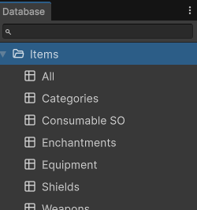

# Getting Started

This guide shows how to make a table of your assets, open it in the *Database* window, and edit its values.

## 1. Declare a table

A table lists every asset of a `ScriptableObject` type. Mark the type with `[Table]`, and the fields to show with `[Column]`:

```cs
using UnityEngine;
using SideXP.Database;

[CreateAssetMenu(menuName = "My Game/Weapon")]
[Table("Items/Weapons")]
public class WeaponSO : ScriptableObject
{
    [SerializeField, Column]
    [Tooltip("The name shown to the players.")]
    private string _displayName = string.Empty;

    [SerializeField, Column(Width = 80)]
    private int _damage = 10;

    [SerializeField, Column(Width = 80)]
    private float _attackSpeed = 1;
}
```

- The `/` in the name of a table groups it with other tables (here, the tables of the *Items*).
- A column shows a field serialized by Unity: public, or marked with `[SerializeField]`.
- The `[Tooltip]` of a field is shown when hovering its column header.

See [Declaring tables](guides/declaring-tables.md) for all the options, and for tables shared by a family of types.

## 2. Open the Database window

Open the window from `Tools > Sideways Experiments > Database`. It lists the tables of your project: click one to open it.



The table shows one row per asset of the type, including the assets of its derived types and the sub-assets. The first column holds the name of the asset, and stays visible when you scroll horizontally. The last column holds buttons to ping, duplicate and delete the asset.

If the table is empty, create your first assets with the *Create* button of the toolbar.

## 3. Edit the values

- **Double-click** a cell to edit it, or select it and press *Enter*, *F2*, or start typing.
- Press *Enter*, or click elsewhere, to confirm the value. Press *Escape* to cancel.
- **Checkboxes and dropdowns** (booleans, enums) change the value in one click.
- Each change is a single Undo step: use `Edit > Undo` as usual.

## 4. Find your assets

- Click a column header to **sort** the rows by that column, and click again to reverse the order.
- Type in the **search** field of the toolbar to show only the rows that contain each word, in any cell.
- Click the *View* button at the right of the toolbar to build **filters** on the columns.
- Right-click an asset in the Project window and choose **Open In Database** to open its table and jump to its row. The Inspector of the asset has the same button in its header.

## 5. Edit many assets at once

- **Select** several cells: *Shift*-click a range, *Ctrl*-click cells one by one, or click the row handles and the headers (with *Shift*) for whole rows and columns.
- **Edit** a selected cell: the value applies to the other selected cells of its column. Hold *Alt* to apply it to all the selected cells of the same type.
- **Copy and paste** the selection with *Ctrl*+*C* and *Ctrl*+*V*, in the table or from a spreadsheet app.

## Next steps

- [The Database window](guides/database-window.md): everything the window can do.
- [Views and filters](guides/views-and-filters.md): save layouts of a table, filter its rows, and share views with your team.
- [Import and export](guides/import-export.md): edit a table in a spreadsheet app.
- [Declaring tables](guides/declaring-tables.md): the options of `[Table]` and `[Column]`, and the columns of nested fields.
- [Computed columns](guides/computed-columns.md): columns of values computed by a method.
- [Custom cell handlers](guides/cell-handlers.md): change how the values of a type are displayed and edited.
