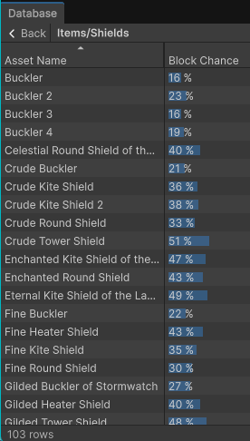

# Custom cell handlers

A cell handler defines how the cells of a column handle their values. Write one to change how the values of a type, or of the fields that have an attribute, are displayed, edited, sorted and converted to text. It's the equivalent of a property drawer, for the cells of the *Database* window.



## Example: percentages

This handler displays the `float` fields marked with a `[Percent]` attribute as a percentage, over a bar filled with the ratio. The attribute goes in a runtime assembly, next to the types that use it:

```cs
using System;

[AttributeUsage(AttributeTargets.Field)]
public class PercentAttribute : Attribute { }
```

The handler goes in an editor assembly:

```cs
using System;
using System.Globalization;

using UnityEngine;
using UnityEngine.UIElements;

using SideXP.Database.EditorOnly;

[CustomCellHandler(typeof(PercentAttribute))]
public class PercentCellHandler : CellHandler
{
    private static readonly Color BarColor = new Color(0.2f, 0.6f, 1f, 0.35f);

    // Creates the element of a cell, reused for other rows when the table scrolls
    public override VisualElement CreateDisplay()
    {
        VisualElement container = new VisualElement();
        container.style.flexGrow = 1;
        container.style.flexDirection = FlexDirection.Row;
        container.style.alignItems = Align.Center;

        VisualElement bar = new VisualElement();
        bar.style.position = Position.Absolute;
        bar.style.left = 0;
        bar.style.top = 2;
        bar.style.bottom = 2;
        bar.style.backgroundColor = BarColor;
        container.Add(bar);

        // The class of the default labels, so the text looks like the other cells
        Label label = new Label();
        label.AddToClassList(DisplayLabelClass);
        container.Add(label);
        return container;
    }

    // Shows a value in an element created by CreateDisplay()
    public override void BindDisplay(VisualElement element, object value, CellContext context)
    {
        float ratio = value is float number ? number : 0;
        element[0].style.width = Length.Percent(Mathf.Clamp01(ratio) * 100);
        ((Label)element[1]).text = ToText(value);
    }

    // Used by the display, the search and the edit as text
    public override string ToText(object value)
    {
        return value is float ratio
            ? $"{(ratio * 100).ToString("0.#", CultureInfo.InvariantCulture)} %"
            : base.ToText(value);
    }

    // Converts a typed text back to a value
    public override bool TryParse(string text, Type valueType, out object value)
    {
        value = null;
        if (text == null || valueType != typeof(float))
            return false;

        string number = text.Trim().TrimEnd('%');
        if (!float.TryParse(number, NumberStyles.Float, CultureInfo.InvariantCulture, out float percent))
            return false;

        value = percent / 100;
        return true;
    }
}
```

Then mark your fields:

```cs
[SerializeField, Percent]
[Column(Width = 100)]
private float _blockChance = 0.25f;
```

## Registration

`[CustomCellHandler(typeof(T))]` registers a handler, like `[CustomPropertyDrawer]` does for property drawers. `T` is either:

- an **attribute type**: the handler is used for the fields that have that attribute;
- a **value type**: the handler is used for the values of that type. Enable `UseForDerivedTypes` to use it for the derived types too, unless they have their own handler.

A column uses a single handler: the one of the first attribute of its field that has a handler, then the one of its value type, then the default handler, which displays the values as text.

- The handler classes are found automatically: no other registration is needed.
- A handler of your project replaces a built-in handler of the package for the same type, so you can change how the built-in types are displayed.
- If two handlers of your project are registered for the same type, a warning is logged, and the first one by type name is used.

> A column can't name its handler directly: `[Column]` is used in runtime assemblies, which can't reference the editor assemblies of the handlers. To give a single column its own handler, declare an attribute for it, as in the example.

## The parts of a handler

A handler has four parts. Each has a default, so override only what you change.

| Part | Methods | Default |
|---|---|---|
| Display | `CreateDisplay()`, `BindDisplay()` | A label with the text of the value |
| Edit | `CreateEditField()`, `TryGetEditedValue()` | The field that matches the type of the value, or a text field through the text conversion, if the text converts back |
| Compare | `CanCompare()`, `Compare()` | Empty values first, natural order for texts, `IComparable` for the other types |
| Text conversion | `ToText()`, `TryParse()` | Invariant culture for numbers, names for enums |

### Display

- **A single instance** of each handler is shared by all the cells of all the tables: a handler must not keep any state about a cell.
- **Elements are reused** for other rows when the table scrolls: `BindDisplay()` must set everything that depends on the value.
- A display shows a single line, and fills its cell. To adapt it to the width of its cell (for example to hide a part of it in narrow columns), register a `GeometryChangedEvent` callback on the element, and read the width of its parent, the cell.
- The display shows the cached value of the cell, and is bound again when the asset changes. It must never read nor write the asset itself.
- `CellContext` gives the asset of the row, the field of the column (to read its attributes) and the type of the values of the column.
- Use `DisplayLabelClass` on your labels so they look like the other cells.

### Live controls

A live control changes the value in one click, without entering the edit mode, like the built-in checkboxes and dropdowns. In `CreateDisplay()`, call `SetLiveControl()` on the control, then call `SubmitValue()` when its value changes:

```cs
public override VisualElement CreateDisplay()
{
    Toggle toggle = new Toggle();
    SetLiveControl(toggle);
    toggle.RegisterValueChangedCallback(evt => SubmitValue(toggle, evt.newValue));
    return toggle;
}

// Without notifying a change, so binding a value doesn't submit it
public override void BindDisplay(VisualElement element, object value, CellContext context)
{
    ((Toggle)element).SetValueWithoutNotify(value is bool isOn && isOn);
}

// A live control usually has no edit mode
public override VisualElement CreateEditField(SerializedProperty property, object value, CellContext context)
{
    return null;
}
```

The window writes the submitted value to the asset of the cell, as a single Undo step. If the value can't be written, the cell shows the value of the asset again.

### Edit

- `CreateEditField()` creates the field shown in edit mode, which replaces the display until the edit ends. Return null if the cell can't be edited.
- `TryGetEditedValue()` gives the value to write when the edit is confirmed. Return false to write nothing (the value is rejected, or the field is bound to the property and writes it itself).
- Use `EditFieldClass` on your fields so they fill the cell like the others.
- `ClampToFieldLimits()` applies the limits of `[Range]` and `[Min]` of the field, which a custom handler registered for another attribute would ignore otherwise.

### Compare

`CanCompare()` is called once per column when the table opens: return false for the values that can't be sorted, and the header of the column won't react to clicks. `Compare()` then compares two cached values of the column.

### Text conversion

`ToText()` and `TryParse()` convert the values to text and back. The search uses `ToText()`, and the edit as text uses both. Override the `TryParse()` overload that takes a `CellContext` when the value depends on the field of the cell (for example to apply the limits of its attributes).

## Errors

If a handler throws, the error is logged once per column, and the other cells are still displayed: a broken handler never breaks the whole table.
