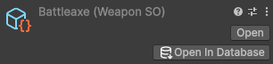

# The Database window

> `Tools > Sideways Experiments > Database`

The *Database* window shows the assets of a type as a table: one row per asset, one column per field. It has two pages: the list of the tables, and the open table.

## Table list

The window opens on the list of the tables of your project, as a tree: the `/` in the names of the tables make groups (`Items/Weapons` is the *Weapons* table of the *Items* group). Groups and tables are sorted together by name.

- Click a group to expand or collapse it, or use its arrow. *Alt*-click the arrow to expand or collapse its subgroups too. The groups are collapsed until you expand them, and the window remembers the expanded ones.
- Click a table to open it.
- Type in the search field to filter the tables. The search reads the whole names, so the name of a group shows all its tables. While you search, the groups of the matching tables are expanded.
- The tables of obsolete types have a mark.

The open table, the searches and the expanded groups are remembered when scripts are compiled, and when the editor is restarted.

## Table view

From top to bottom:

- **Toolbar**: the *Back* button (to the table list), the name of the table, the [search](#search) field, the [view](views-and-filters.md#views) button, the [*Create*](#create) button, the [*Refresh*](#reloading) button, the [*Import/Export*](import-export.md) button, the [*Sync Selection*](#selection-sync) toggle, and the *View* button, which shows the [view panel](views-and-filters.md#the-view-panel).
- **Table**: the column headers and the rows. Each row starts with a handle that shows its number, to [select](#selection) the whole row. The first column stays visible when you scroll horizontally.
- **Status line**: the number of rows (and of visible rows when the search or the filters hide some), the number of selected cells and assets, then on the right the [page](#pages) controls and the number of rows per page.

Two built-in columns come with every table:

- **Asset Name**: the name of the asset, first by default. It can be hidden by default with the `HideAssetName` option of `[Table]`.
- **Controls**: last, with buttons to [ping](#ping-and-select), [duplicate](#duplicate) and [delete](#delete) the asset of the row.

## Selection

Click a cell to select it: it becomes the **active cell**, which has an outline. Then build a selection of any cells, not necessarily next to each other:

| Gesture | Effect |
|---|---|
| Click | Selects the cell, which becomes the active cell |
| *Shift*-click | Selects the range between the active cell and the clicked cell |
| *Ctrl*-click | Adds the cell to the selection, or removes it |
| *Ctrl*+*Shift*-click | Adds the range to the selection |
| Drag from a cell | Selects the range between the pressed cell and the cell under the pointer. *Shift* and *Ctrl* work like with a click |
| Click a row handle | Selects the whole row. *Shift*, *Ctrl* and dragging work like with the cells |
| *Shift*-click a header | Selects the whole column |
| *Ctrl*-click a header | Adds the whole column to the selection, or removes it. The context menu of the header does the same |
| *Shift*-drag or *Ctrl*-drag from a header | Selects the whole columns between the pressed header and the column under the pointer. *Ctrl* adds them to the selection |

On macOS, use *Cmd* instead of *Ctrl*.

- A click on a header without these keys [sorts](#sorting) the rows.
- A click on a checkbox or a dropdown changes its value and keeps the selection. To start a drag from such a cell, press the rest of the cell.
- The selection is kept when you sort, search, browse the pages, or when the table reloads. The cells of the rows that the search or the filters hide leave the selection, so copying, pasting and editing never change rows you can't see.
- A range spans the rows in the order they are displayed, across the pages, and includes the cells of the hidden columns between its two cells.

## Editing values

Double-click a cell, or select it and use the keyboard:

| Action | Effect |
|---|---|
| Double-click, *Enter* or *F2* | Edits the active cell |
| Typing a character | Edits the active cell (texts and numbers), starting with that character |
| *Enter*, or clicking elsewhere | Confirms the value |
| *Escape* | Cancels the edit, and restores the previous value |

- Each edit is a single Undo step.
- A number that doesn't fit in the type of its field (`300` for a `byte`) is rejected, with a warning. The limits of `[Range]` and `[Min]` are applied, like in the Inspector.
- The edit stays open while a picker or a menu of the field is open (object picker, color picker, curve editor).
- Leaving the table, or scrolling the edited cell out of view, confirms the edit.

**Checkboxes and dropdowns** (booleans, enums, [`[AssetDropdown]`](declaring-tables.md#assetdropdown) fields) are always interactive: clicking them changes the value in one click, as a single Undo step, without selecting the cell nor ending an edit in progress. Clicking the rest of their cell selects it.

### Editing several cells

When the edited cell is part of a selection, the new value also applies to the **other selected cells of its column**. Clicking a checkbox in a selection of whole rows only changes that column.

Hold **Alt** (*Option* on macOS) to apply the value to **all the selected cells of the same type**, in any column:

| Edit | With *Alt* |
|---|---|
| Texts and numbers | *Alt*+*Enter* confirms the value |
| Checkboxes | *Alt*-click |
| Dropdowns | *Alt*-click opens the dropdown, and the chosen value applies to all the cells of the same type |

- **Same type** means the same field type: an `int` column and a `float` column are different types, and so are two enum types, or references to two types of assets.
- While *Alt* is held, the cells that an edit would change get a subtle outline. When they have different values, the edited cell shows the mixed value indicator of Unity.
- The value is only applied to the other cells if you changed it: confirming a field without typing anything never overwrites them.
- Editing a cell that isn't selected only changes that cell.
- Each cell receives the value through the handler of its column, which can refuse it, or clamp it to the limits of `[Range]` and `[Min]`. The cells that refuse it, and the cells that can't be edited (the *Asset Name*, [computed columns](computed-columns.md)), are left unchanged, and listed in a warning.
- All the changes are a single Undo step.

## Copy and paste

*Ctrl*+*C* and *Ctrl*+*V* (*Cmd* on macOS) copy and paste the selected cells as tab-separated text, the format of spreadsheet apps: you can copy cells to Excel or Google Sheets, and paste them back.

- The values are copied as the cells display them: the names of enums, the paths of references, numbers in the invariant culture (`0.5`).
- **Copy**: the selection must form a grid, where every selected row has the same selected columns. The columns don't need to be next to each other: the copy holds the selected rows and columns, in display order.
- **Paste a single value**: it's applied to all the selected cells.
- **Paste a grid**: it's applied to a selection of the same size, or from the active cell when a single cell is selected (filling the next columns and rows). It must fit in the table. The pasted cells then become the selection.
- The texts that a cell can't convert (for example a number with a decimal comma) and the cells that can't be edited are left unchanged, and listed in a warning. The *Controls* column is never copied, and never receives a value.
- A paste is a single Undo step. A copy or a paste that isn't possible shows the reason in the window.

While a cell is edited, its field handles the copy and the paste.

## Sorting

Click a column header to sort the rows by that column, and click it again to reverse the order.

To sort by several columns (by tier, then by price), **Alt-click** the headers: *Alt*-click adds the column to the sort, ascending, a second *Alt*-click makes it descending, and a third one removes it from the sort. When several columns are sorted, their headers show their order beside the sort icon. A click without *Alt* sorts by that column only again.

The context menu of the headers has the same actions: *Add to Sort* or *Remove from Sort*, and *Clear Sort*.

- The sort is stable: rows with equal values keep their order.
- Texts are sorted like in the Project window (`Sword 2` before `Sword 10`).
- Empty values come first. References are sorted *None* first, then missing assets, then by name.
- Enums are sorted by value, in their declaration order.
- Colors, arrays and lists can't be sorted: their headers don't react to clicks.
- Hiding a sorted column removes it from the sort.

## Search

Type in the search field of the toolbar to show only the rows that contain **each word** of the search, in any order and ignoring case. A word can be found in the asset name or in any displayed cell, but never across two cells.

- Cells are searched as they are displayed: the names of enums, the paths of references, numbers in the invariant culture (`0.5`). The values of [computed columns](computed-columns.md) are searched too.
- Hidden columns are not searched, so every match can be seen, except the asset name, which is always searched.
- The search applies on top of the [filters](views-and-filters.md#filters). It's not part of the view: it's kept when you switch views, and cleared when you open another table, or when a new asset (created or duplicated) would be hidden by it.

## Pages

The rows are shown in pages, 100 rows per page by default. The controls on the right of the status line show the first, previous, next and last pages. Type the number of a page in its field, or the number of rows per page in the last field, then press *Enter*.

- The number of rows per page is a preference of yours, shared by all your projects. A change applies to all the open tables. It can also be changed from the *Sideways Experiments > Database* page of the Preferences window. Pages have at least 10 rows.
- The row numbers continue across the pages: the first row of the second page of 100 is 101.
- The pages are only a display: the [selection](#selection), the copy and the edits include the selected cells of the other pages.
- A new search, other filters or folders, another sort or another view show the first page. Showing an asset (created, duplicated, or with [*Open In Database*](#open-in-database)) shows its page.

## Columns

- **Reorder** a column by dragging its header, and **resize** it by dragging the edge of its header. The first column (the frozen one) can't be moved, and the other columns can't be dragged before it.
- **Right-click** a header for its menu: add the column to the [selection](#selection), the [sort](#sorting) items, *Filter by This Column* (see [Filters](views-and-filters.md#filters)), then every column of the table, checked when it's shown, to show or hide it, including the built-in ones. *Show All Columns* shows the hidden ones back, and *Reset View* restores the default order, widths and visibility of the columns, and removes the sort.

The layout of the columns and the sort are settings of the open [view](views-and-filters.md#views), saved as soon as you change them.

## Asset operations

### Create

The *Create* button of the toolbar (and the button shown when the table is empty) creates an asset of the table, then asks where to save it. The save dialog opens in the folder of the active cell's asset, or of the first row. When the table has no row and the view has a [folder scope](views-and-filters.md#folder-scope), it opens in the first folder of the scope.

When the table has several types that can be created (an abstract table type, or a type with derived types), a menu lets you choose the type first: the button then shows an arrow. Abstract types are left out. A type without a script file of its own (for example a type declared in a file named after another type) can't be saved as an asset: creating it is refused, with a warning.

The new asset becomes the active cell, so you can rename it right away with *F2* or by typing.

### Rename

Edit a cell of the *Asset Name* column like any other cell. The asset is renamed when the edit is confirmed.

- Renaming a main asset renames its file, which can't be undone, like in the Project window. Renaming a sub-asset is an Undo step.
- A name that Unity refuses (another file with that name, invalid characters) leaves the asset unchanged, with a warning.
- Renaming is allowed by the `AllowRenameAsset` option of `[Table]`. The option belongs to the type of the asset: if a type forbids it, its assets can't be renamed in any table.

### Duplicate

The duplicate button of the *Controls* column copies the asset: next to the original for a main asset (with its sub-assets), in the same file for a sub-asset. The copy becomes the active cell.

### Delete

The delete button of the *Controls* column deletes the asset, after a confirmation. A main asset is moved to the trash of your system, with its sub-assets. A sub-asset is removed from its file, which can be undone.

### Ping and select

The ping button of the *Controls* column selects the asset, and shows it in the Project window.

## Selection sync

The *Sync Selection* toggle of the toolbar links the selection of the table with the selection of Unity. It's disabled by default, since it changes the selection of the whole editor, which other windows react to. When it's enabled:

- Selecting cells selects the assets of their rows in Unity, so the Inspector shows them. With several rows, the Inspector edits all their assets at once, including the fields that have no column.
- The rows of the assets selected elsewhere (in the Project window, for example) are highlighted, with a lighter color than the selection. Selecting assets elsewhere never changes the selection of the table.

The toggle is remembered by the window.

## Open In Database

Right-click an asset (or a sub-asset) in the Project window and choose **Open In Database**: the window opens its table, makes it the active cell, and scrolls to its row, on its page. A search that would hide it is cleared.

When several tables list the asset (the table of its type, and the tables of its base types), a menu lets you choose one, the nearest table first. From the `Assets` menu of the menu bar, the nearest table opens directly.

The **Inspector** of an asset that has a table shows an *Open In Database* button in its header, which does the same. When several tables list the asset, the menu of the tables opens under the button. The button is only shown when a single asset is inspected.

If the [filters or the folder scope](views-and-filters.md) of the view hide the asset, they are kept, and the window shows a message that says why the asset isn't shown.

## Reloading

The table follows the changes made outside of the window: edits in the Inspector, Undo and Redo, and assets imported, created, moved or deleted.

The *Refresh* button loads the assets again, for the changes Unity isn't told about, such as a script that writes a field without marking its asset dirty.

> When a table is opened without any asset, all its columns are shown. Columns that Unity can't serialize are only detected from an asset, so they disappear the next time the table is opened.
