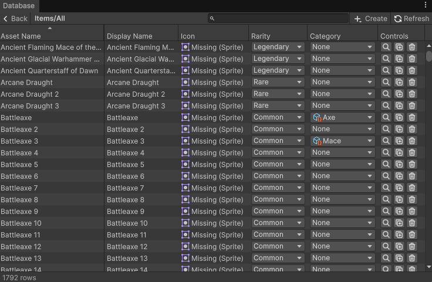
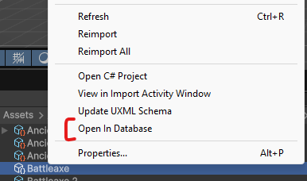

# The Database window

> `Tools > Sideways Experiments > Database`

The *Database* window shows the assets of a type as a table: one row per asset, one column per field. It has two pages: the list of the tables, and the open table.

## Table list

The window opens on the list of the tables of your project, sorted by name. Type in the search field to filter them, and click a table to open it. The tables of obsolete types have a mark.

The open table and the searches are remembered when scripts are compiled, and when the editor is restarted.

## Table view

From top to bottom:

- **Toolbar**: the *Back* button (to the table list), the name of the table, the [search](#search) field, the [*Create*](#create) button, and the [*Refresh*](#reloading) button.
- **Table**: the column headers and the rows. The first column stays visible when you scroll horizontally.
- **Status line**: the number of rows, and the number of visible rows when the search hides some.

Two built-in columns come with every table:

- **Asset Name**: the name of the asset, first by default. It can be hidden by default with the `HideAssetName` option of `[Table]`.
- **Controls**: last, with buttons to [ping](#ping-and-select), [duplicate](#duplicate) and [delete](#delete) the asset of the row.

## Editing values

Click a cell to make it the **active cell**, which is highlighted. Then:

| Action | Effect |
|---|---|
| Double-click, *Enter* or *F2* | Edits the active cell |
| Typing a character | Edits the active cell (texts and numbers), starting with that character |
| *Enter*, or clicking elsewhere | Confirms the value |
| *Escape* | Cancels the edit, and restores the previous value |

- Each edit is a single Undo step.
- A number that doesn't fit in the type of its field (`300` for a `byte`) is rejected, with a warning. The limits of `[Range]` and `[Min]` are applied, like in the Inspector.
- The edit stays open while a picker or a menu of the field is open (object picker, color picker, curve editor).
- Leaving the table, or scrolling the edited cell out of view, confirms the edit.

**Checkboxes and dropdowns** (booleans, enums, [`[AssetDropdown]`](declaring-tables.md#assetdropdown) fields) are always interactive: clicking them changes the value in one click, as a single Undo step, without selecting the cell nor ending an edit in progress. Clicking the rest of their cell selects it.

## Sorting

Click a column header to sort the rows by that column, and click it again to reverse the order. The table is sorted by a single column.

- Texts are sorted like in the Project window (`Sword 2` before `Sword 10`).
- Empty values come first. References are sorted *None* first, then missing assets, then by name.
- Enums are sorted by value, in their declaration order.
- Colors, arrays and lists can't be sorted: their headers don't react to clicks.

## Search

Type in the search field of the toolbar to show only the rows that contain **each word** of the search, in any order and ignoring case. A word can be found in the asset name or in any displayed cell, but never across two cells.

- Cells are searched as they are displayed: the names of enums, the paths of references, numbers in the invariant culture (`0.5`).
- Hidden columns are not searched, except the asset name, which is always searched.
- The search is cleared when you open another table, or when a new asset (created or duplicated) would be hidden by it.

## Columns

- **Reorder** a column by dragging its header, and **resize** it by dragging the edge of its header. The first column (the frozen one) can't be moved.
- **Right-click** a header to show or hide each column, including the built-in ones. *Show All Columns* shows the hidden ones back, and *Reset View* restores the default order, widths and visibility of the columns, and removes the sort.

The layout and the sort of each table are remembered between sessions. They are personal: they are saved in the `UserSettings/` folder of the project, which is usually not shared with version control.

## Asset operations

### Create

The *Create* button of the toolbar (and the button shown when the table is empty) creates an asset of the table, then asks where to save it. The save dialog opens in the folder of the active cell's asset, or of the first row.

When the table has several types that can be created (an abstract table type, or a type with derived types), a menu lets you choose the type first: the button then shows an arrow. Abstract types are left out. A type without a script file of its own (for example a type declared in a file named after another type) can't be saved as an asset: creating it is refused, with a warning.

The new asset becomes the active cell, so you can rename it right away with *F2* or by typing.

### Rename

Edit a cell of the *Asset Name* column like any other cell. The asset is renamed when the edit is confirmed.

- Renaming a main asset renames its file, which can't be undone, like in the Project window. Renaming a sub-asset is an Undo step.
- A name that Unity refuses (another file with that name, invalid characters) leaves the asset unchanged, with a warning.
- Renaming is allowed by the `AllowRenameAsset` option of `[Table]`. The option belongs to the type of the asset: if a type forbids it, its assets can't be renamed in any table.

### Duplicate

The duplicate button of the *Controls* column copies the asset: next to the original for a main asset (with its sub-assets), in the same file for a sub-asset. The copy becomes the active cell.

### Delete

The delete button of the *Controls* column deletes the asset, after a confirmation. A main asset is moved to the trash of your system, with its sub-assets. A sub-asset is removed from its file, which can be undone.

### Ping and select

The ping button of the *Controls* column selects the asset, and shows it in the Project window.

## Open In Database

Right-click an asset (or a sub-asset) in the Project window and choose **Open In Database**: the window opens its table, makes it the active cell, and scrolls to its row. A search that would hide it is cleared.

When several tables list the asset (the table of its type, and the tables of its base types), a menu lets you choose one, the nearest table first. From the `Assets` menu of the menu bar, the nearest table opens directly.

## Reloading

The table follows the changes made outside of the window: edits in the Inspector, Undo and Redo, and assets imported, created, moved or deleted.

The *Refresh* button loads the assets again, for the changes Unity isn't told about, such as a script that writes a field without marking its asset dirty.

> When a table is opened without any asset, all its columns are shown. Columns that Unity can't serialize are only detected from an asset, so they disappear the next time the table is opened.
