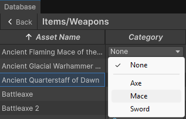
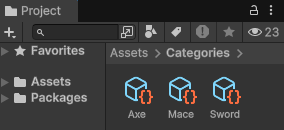

# Declaring tables

Tables are declared in code, with two attributes of the `SideXP.Database` namespace: `[Table]` on a `ScriptableObject` type, and `[Column]` on the fields to show. Both are stripped from player builds.

Columns can also show values computed by a method, instead of a field: see [Computed columns](computed-columns.md).

## `[Table]`

Makes a `ScriptableObject` type a table. The table lists every asset of the type found in the project, including the assets of its derived types and the sub-assets (except the ones hidden from the Project window).

```cs
[Table("Items/Equipment", AllowRenameAsset = true)]
public abstract class EquipmentSO : ScriptableObject { }
```

| Option | Default | Description |
|---|---|---|
| `Name` (or the first argument) | The type name, nicified | The name of the table in the table list. A `/` groups tables together (`Items/Equipment`) |
| `Inherited` | `false` | Makes this type and all its derived types tables (see [Inheritance](#inheritance)) |
| `HideAssetName` | `false` | Hides the *Asset Name* column by default. You can still show it from the context menu of the headers, and the asset names are still searched |
| `AllowRenameAsset` | `true` | Allows renaming the assets of this type from the *Asset Name* column (see [Renaming](database-window.md#rename)) |

- Abstract types can be tables, to list a family of types: `EquipmentSO` above lists the weapons, shields and armor pieces.
- Open generic types (`MyTable<T>`) are never tables, since they can't have assets.
- A type marked with `[Obsolete]` is still a table, with a mark in the window, so you can find and migrate its assets.

### Inheritance

By default, `[Table]` only applies to its own type: a derived type isn't a table, but its assets are rows of the table of its base type, with the columns of the base type.

With `Inherited = true`, every derived type is a table too:

```cs
[Table("Items/All", Inherited = true)]
public abstract class ItemSO : ScriptableObject { }

// A table named "Items/Consumable SO", with the columns of ItemSO and ConsumableSO
public class ConsumableSO : ItemSO { }

// Its own declaration replaces the inherited one: a table named "Items/Equipment", not passed on to its derived types
[Table("Items/Equipment")]
public abstract class EquipmentSO : ItemSO { }

// Not a table: its assets are rows of the "Items/Equipment" and "Items/All" tables
public class WeaponSO : EquipmentSO { }
```

- The nearest declaration wins: a type's own `[Table]` replaces the one of its base type, and the inheritance stops at a declaration without `Inherited`.
- An inherited table is named after its type, in the same group as the table of its base type, and copies the other options of its declaration.
- A derived type can't opt out of an inherited table. To change its name or its options, give it its own `[Table]`.

### Remembered settings and type names

The window saves the [views](views-and-filters.md) of each table (column order, widths, hidden columns, sort, filters, folders). A table is identified by the GUID of the script file of its type, so its views are kept when you rename the type, as long as you rename its script file from Unity. A type without a script file of its own (a nested type, a type in a DLL) is identified by its full name instead.

## `[Column]`

Shows a field as a column of its type's table.

```cs
[SerializeField]
[Column("Price", Width = 80)]
private int _basePrice = 0;
```

| Option | Default | Description |
|---|---|---|
| `Name` (or the first argument) | The field name, nicified (`_basePrice` becomes *Base Price*) | The text of the column header |
| `Width` | `0` | The default width of the column, in pixels. With `0` or less, the column is flexible: the flexible columns share the width left by the others |
| `Path` | None | A field nested in the marked field, to show instead of the marked field (see [Nested fields](#nested-fields)) |

- The field must be serialized by Unity: public, or marked with `[SerializeField]`. Fields that Unity can't serialize are skipped, with a warning in the console.
- The field can be declared on the table type or any of its base types. The columns go from the root base type down to the table type, then in declaration order within each type.
- The `[Tooltip]` of the field is shown when hovering its column header.
- An auto-property can be a column too, with `[field: SerializeField, Column]`: the column is named after the property.

### Nested fields

The fields of a serializable struct or class can each have a column. Give the field one `[Column]` per nested field, with its `Path`:

```cs
[Serializable]
public struct ItemBonuses
{
    [Range(0, 10)]
    public int strength;
    public int agility;
    public ElementalResistances resistances;
}

[Serializable]
public struct ElementalResistances
{
    public float fire;
    public float frost;
}

public abstract class EquipmentSO : ScriptableObject
{
    // Three columns: "Strength", "Agility", and "Fire Res."
    [SerializeField]
    [Column(Path = "strength")]
    [Column(Path = "agility")]
    [Column("Fire Res.", Path = "resistances.fire")]
    private ItemBonuses _bonuses;
}
```

- A path holds the names of the nested fields, separated with dots, from the marked field down to the value to show (`resistances.fire`).
- The columns of a field are in the order of its attributes.
- A nested column is named after its nested field (*Strength*, not *Bonuses Strength*). Two nested fields with the same name need a `Name` to tell them apart.
- The tooltip of a nested column is the `[Tooltip]` of the nested field, or of the nearest field of the path that has one.
- The attributes of the nested field apply to the cells, like `[Range]` above.
- Each field of the path must be serialized by Unity. It can be declared in its type or in a base type, and the name of an auto-property can be used for its backing field.
- A path can't go through a reference to an asset, an array, a list or a `[SerializeReference]` field: the values of those can't be a single column. An invalid path is skipped, with a warning in the console.
- Two columns can't show the same value: the second one is skipped, with a warning.

### Column identifiers

The views, the filters and the [import](import-export.md#columns) find the columns by their identifier: the name of the field (`_basePrice`), or the path of a nested field (`_bonuses.resistances.fire`). Changing the `Name` of a column keeps its settings, but renaming its field loses them: `[FormerlySerializedAs]` keeps the values of the assets, not the settings of the views.

### Supported values

The cells display and edit the values of most of the types that Unity serializes:

| Values | Display | Edit |
|---|---|---|
| Texts, numbers, characters | Text | Text or number field |
| Booleans | Checkbox, changed in one click | |
| Enums (and flags) | Dropdown, changed in one click | |
| References to assets | Icon and name of the asset | Object field |
| Colors | Color swatch | Color picker |
| Vectors, rects, bounds, quaternions (as Euler angles), layer masks | Text | The field of the type |
| Curves, gradients | Text | The field of the type |
| Arrays, lists, other structs and classes | Text | Not editable |

Some attributes of Unity change the cells:

- `[Range]`: the value is clamped to the range, and edited with a slider (for `float` and `int`, when the column is wide enough).
- `[Min]`: the value is clamped to the minimum.
- `[ColorUsage]`: the color picker follows its HDR and alpha options.

To change how the values of a type, or of the fields that have an attribute, are handled, write a [custom cell handler](cell-handlers.md).

> Property drawers are never used in the cells: they are designed for the Inspector, which has more room than a cell. A cell handler gives the cells a GUI designed for them.

## `[AssetDropdown]`

The [`[AssetDropdown]`](https://side-xp.github.io/unity-core/guides/inspector-attributes/#assetdropdown) attribute of the core lib (`SideXP.Core` namespace) draws a reference to an asset as a dropdown of every asset of its type. In a table, its cells are dropdowns too, changed in one click.

```cs
[SerializeField]
[AssetDropdown]
[Column(Width = 120)]
private ItemCategorySO _category = null;
```




## Opening a table from code

`DatabaseWindow` (in the `SideXP.Database.EditorOnly` namespace) opens the window from your own editor tools:

```cs
// Opens the window, or focuses it
DatabaseWindow.Open();

// Opens the window on the table of a type
DatabaseWindow.Open(typeof(WeaponSO));
```
