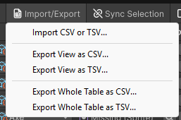

# Import and export

The rows of a table can be exported to a CSV or TSV file, edited in a spreadsheet app (Excel, Google Sheets, LibreOffice), then imported back. Useful to balance many values with formulas, or to review them with people who don't use Unity.

Both are in the menu of the *Import/Export* button of the toolbar.

## Export

| Item | Rows | Columns |
|---|---|---|
| *Export View as CSV...*, *Export View as TSV...* | The visible rows of all the pages, in their order: the filters, the folder scope and the search apply | The displayed columns, in their order |
| *Export Whole Table as CSV...*, *Export Whole Table as TSV...* | Every asset of the table in the project, ignoring the filters, the folder scope and the search | All the columns, hidden and [computed](computed-columns.md) ones included, in the default order |

A save dialog then asks where to write the file. It opens in the folder of the last exported or imported file, with the name of the table (and of the view, for a view).

- **CSV** separates the values with commas, **TSV** with tabs. Values that contain the separator, quotes or line breaks are quoted, like spreadsheet apps do.
- The first row holds the names of the columns, as the headers show them.
- The first column, *GUID*, identifies the assets: the GUID of the file for a main asset, followed by `:` and the local file identifier for a sub-asset. It's what the import uses to find the assets again, even if they were renamed or moved: don't change it.
- The values are written as the cells display them: the names of enums, the paths of references, numbers with a dot before the decimals. The *Controls* column is never exported.
- The files are encoded in UTF-8, with the mark that tells Excel to read the accents correctly.

> A file open in a spreadsheet app may be locked: close it in the app before exporting to it again.

## Import

*Import CSV or TSV...* opens a file, then a preview of its changes. Nothing changes before you click *Apply*.

### Files

- The format comes from the extension of the file: `.csv` or `.tsv`.
- A CSV file is read with commas, or with semicolons if its first row has more of them. Spreadsheet apps write semicolons in the languages that use a comma before the decimals (French, German).
- Numbers must still be written with a dot before the decimals: a number with a decimal comma can't be converted, and is reported.

### Columns

The columns of the file are matched with the columns of the table by their name, ignoring case, then by their identifier (the name of the field, for example `_basePrice`).

- The *GUID* column (the first column named *GUID*) identifies the assets.
- A column that matches no column of the table is **unknown**: by default it's ignored, and its dropdown in the preview maps it to a column of the table that no other column of the file fills.
- The columns of the table that can't be edited ([computed columns](computed-columns.md)) are shown as read-only, and their values are ignored.

### Rows

Each row is matched with an asset among **all** the assets of the table in the project (not only those of the view):

1. By the *GUID* column: a GUID, a GUID followed by the local file identifier of a sub-asset, or a path (for files written by hand, with `#` and the name of a sub-asset, like the text of references).
2. Otherwise, by the *Asset Name* column, ignoring case.

- A path or a name shared by several assets matches none of them: the row is **ambiguous**, and skipped.
- A row that matches the same asset as an earlier row is skipped.
- The assets that the file doesn't list are never changed: an import never deletes anything.

### Values

- Each value is converted by the handler of its column, like a pasted value, and compared with the cell as it's displayed (`1.50` is not a change of `1.5`). Only the values that differ are changed.
- A text that can't be converted is skipped, and reported. An empty text that can't be converted (a number left empty) leaves the cell as it is.
- A different *Asset Name* renames the asset.

### Missing assets

The rows that match no asset can create new assets. The *Missing Assets* section of the preview, shown when the file has such rows, has a toggle to create them, disabled by default:

- **Type**: when the table has several types that can be created, the type of all the created assets.
- **Folder**: where the assets are created, by default the folder that [*Create*](database-window.md#create) would suggest. *Choose...* picks another folder of the project.
- A created asset is named after its *Asset Name* in the file, or after its type otherwise. A number is added when the name is already taken (`Weapon SO 2`).

### Preview

The preview window shows, from top to bottom:

- The file, the table, and a summary of the rows: changed, renamed, created, unchanged and skipped, and the values that can't be converted.
- **Columns**: how each column of the file is matched, with a dropdown for the unknown ones.
- **Missing Assets**: see [above](#missing-assets).
- **Changes**: each row that changes, with how it was matched (by GUID, path or name), its old and new values, its new name, and the skipped rows and values. The unchanged rows are only counted in the summary.
- What *Edit > Undo* will revert, then *Cancel* and *Apply*.

Each choice made in the preview updates the changes. The preview is modal: the assets can't change while it's open.

### Undo

The values and the renames of sub-assets of an import are a single Undo step. Two changes can't be undone, which the preview says:

- Creating assets, like in the Project window.
- Renaming a main asset, which renames its file.

After *Apply*, the table reloads, and the console lists what was changed, and the changes that failed.
