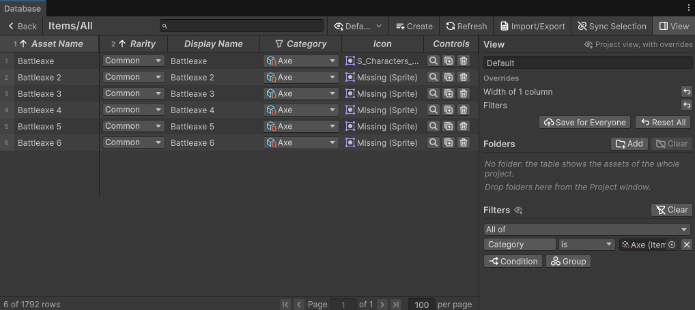

# Views and filters

A **view** holds the display settings of a table: the order, widths and visibility of the columns, the sort, the filters and the folder scope. A table can have several views, to look at the same assets in different ways (the prices of the weapons, the stats of the rare items), and views can be shared with your team.

Each change you make to the columns, the sort, the filters or the folders is saved to the open view right away. The search, the displayed page and the number of rows per page are not part of the views.

## The view panel

The *View* button, at the right end of the toolbar, shows the view panel on the right of the table. The panel stays open while you work in the table, and has three sections:

- **View**: the name of the open view, its [status](#project-views), and the [overrides](#overrides) of a project view.
- **Folders**: the [folder scope](#folder-scope).
- **Filters**: the [filters](#filters).

Each change made in the panel applies to the table right away. The window remembers if the panel is open.

## Filters

The filters show only the rows that meet conditions on their columns. They are built in the *Filters* section of the view panel, as a group of conditions:

- The operator of a group says how its conditions combine: **All of** (a row must meet every condition) or **Any of** (a row must meet at least one).
- The *Condition* button of a group adds a condition on a column, and the *Group* button adds a group inside it, with its own operator (for example, the rare items that are either swords or bows).
- Each condition and group has a button that removes it. *Clear* removes all the conditions.

### Conditions

The kind of a condition comes from the type of the values of its column:

| Values | Condition | New condition |
|---|---|---|
| Numbers | A range: the rows whose value is between *Min* and *Max* (both included). An empty limit means no limit | No limit: keeps all the rows |
| Booleans | *is checked* or *is unchecked* | The checked rows |
| Enums | The values to keep, checked in a menu with *Select All* and *Select None*. For an enum with flags, the rows that have at least one of the checked flags | All the values: keeps all the rows |
| References to assets | *is* an asset (empty for the rows without reference, *None*), or *is missing* (the references to a deleted asset) | The rows without reference |
| Other values | *Contains...*: the rows whose cell contains the text, ignoring case, as the cell displays it | Empty: keeps all the rows |

- The limits of a range are typed with a dot before the decimals, like the cells display numbers. A limit that isn't a number is marked, and not applied.
- Click the column of a condition to pick another column. The condition is kept if it applies to the new column, and replaced by a new condition otherwise.
- Unlike the search, the filters apply to the hidden columns: hiding a column doesn't undo a filter.
- The [computed columns](computed-columns.md) can be filtered too.

### From the headers

*Filter by This Column*, in the context menu of a header, opens the view panel and adds a condition on that column. The headers of the columns used by the filters show a filter icon.

### Missing columns

A condition on a column that doesn't exist anymore (a field removed or renamed), or whose type changed, stays in the panel, marked, and is ignored by the table. Pick another column for it, or remove it. If the column comes back, the condition applies again.

## Folder scope

The *Folders* section of the view panel limits the table to the assets of some folders, and of their subfolders. Without folder, the table shows the assets of the whole project.

- *Add* picks a folder with the folder dialog of your system. It must be a folder of the project: in `Assets`, or in a package.
- You can also drop folders from the Project window onto the section.
- Click a folder to show it in the Project window. Each folder has a button that removes it, and *Clear* removes them all.
- A folder that doesn't exist anymore stays in the list, marked, and is ignored. If none of the folders exists, the table has no row.

The assets outside of the scope are never loaded, so a scope also makes a large table faster to open. They are not rows at all, and the status line counts the rows of the scope only. A new asset, or an asset moved into one of the folders, joins the table, and an asset moved out of them leaves it.

## Hidden assets

When the table is asked to show an asset that the filters or the folder scope hide (a new asset, or [*Open In Database*](database-window.md#open-in-database)), the filters and the scope are kept, and the window shows a message that says why the asset isn't shown. Change the filters or the folders to see it.

## Views

The view button of the toolbar shows the name of the open view. Click it for the menu of the views:

- The views of the table, the open one checked. Pick one to open it.
- **New View**: creates a view with the default settings of the table, and opens it.
- **Duplicate View**: copies the open view, and opens the copy.
- **Rename View...**: opens the view panel, on the name of the view. You can also type the name there at any time, then press *Enter*.
- **Delete View**: deletes the open view, after a confirmation, and opens another one. The last view of a table can't be deleted.
- **Reset View**: restores the default order, widths and visibility of the columns, and removes the sort. The filters and the folders are kept: clear them from the view panel.

A table opens on the view you used last. A table without any view gets a view named *Default* when it's opened. The names of the views of a table are unique: a name already taken gets a number.

Opening another view keeps the search, and shows the first page.

## Project views

The views you create are **personal views**: only you see them. A **project view** is shared with your team, through version control.

- **Share as Project View...**, in the menu of a personal view, moves the view to the project views, after a confirmation. The view stays open, with its settings.
- **Duplicate as Personal View**, in the menu of a project view, copies what you see as a personal view.
- Renaming or deleting a project view changes it for the whole team. The confirmation of a deletion says so.

When the table has project views, the menu lists the views in two groups: *Personal Views*, then *Project Views*.

The icon of the view button, and the title of the *View* section of the panel, show the status of the open view:

| Icon | Status | Meaning |
|---|---|---|
| An eye | *Personal view* | Only you see this view |
| An eye with a check mark | *Project view* | You see the project view as it's saved in the project |
| An eye with a bolt | *Project view, with overrides* | You changed some settings of the project view: what you see differs from what the team sees |

### Overrides

When you change a project view (resize a column, sort, filter), the change is saved as a personal **override** of that view, never in the project file. You can work in a project view as freely as in a personal view, and the changes of your team still reach you: an override only replaces the settings you changed. A change back to the value of the project view removes its override.

While a project view has overrides, the *View* section of the panel lists them under *Overrides*: *Column order*, *Widths of 2 columns*, *Visibility of 1 column*, *Sort*, *Filters*, *Folders*. Then:

- The button of each override discards it, so that setting comes from the project view again.
- **Save for Everyone** writes your overrides to the project view, after a confirmation, then removes them. Only the settings you changed are written: the other settings of the project view are kept.
- **Reset All** discards all your overrides.

The titles of the *Folders* and *Filters* sections have a mark while you override them. The menu of the views has the same actions (*Save My Changes for Everyone...* and *Reset My Changes*), and *Reset View* discards your overrides of the columns and the sort.

If a teammate deletes a project view that you have overrides on, your overrides are removed when you open the table, which opens another view.

## Storage

| Data | File | Version control |
|---|---|---|
| Personal views, overrides of the project views | `UserSettings/SideXP.Database.Views.asset` | Not shared (the `UserSettings` folder is usually ignored) |
| Project views | `ProjectSettings/SideXP.Database.Views.asset` | Shared: commit this file |
| Rows per page | The preferences of the editor | Shared by all your projects |

- Sharing, renaming and deleting a project view, and *Save for Everyone*, write the project file: commit it so your team gets the change. The other changes never write it.
- The files are read once per domain reload: the changes pulled from version control show up after the next compilation, or the next start of the editor.
- All the project views are in a single file. If two people change it at the same time, the conflict can be solved with the Smart Merge tool of Unity (`UnityYAMLMerge`).
- A view refers to the columns by their identifiers. The settings of a column that doesn't exist anymore are ignored, but kept, so they apply again if the column comes back. A new column appears next to the column that precedes it in the default order.
