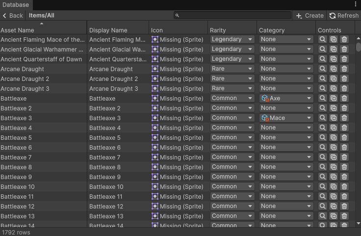

# SideXP - Database (Unity)

Spreadsheet-like view for editing Unity assets in a more practical way.

Balancing a game often means editing dozens of assets of the same kind: items, enemies, levels, upgrades. The Inspector shows one asset at a time, so comparing values or tweaking a whole family of assets takes a lot of clicks. The *Database* window shows every asset of a type as a table, one row per asset and one column per field, and lets you edit the values in place.

```csharp
using UnityEngine;
using SideXP.Database;

// Every asset of this type, and of its derived types, is a row of the "Items/All" table
[Table("Items/All", Inherited = true)]
public class ItemSO : ScriptableObject
{
    [SerializeField, Column]
    private string _displayName = string.Empty;

    [SerializeField, Column("Price", Width = 80)]
    private int _basePrice = 0;
}
```



## Features

- **Tables declared in code**: mark a `ScriptableObject` type with `[Table]` and its fields with `[Column]`. Tables can be passed on to derived types, and abstract types can be tables, to list a family of types.
- **Every asset of the type**: a table lists the assets of its type and of its derived types found in the project, including sub-assets.
- **Edit in place**: double-click a cell, or press *Enter*, *F2* or start typing. Checkboxes and dropdowns change the value in one click. Each edit is a single Undo step.
- **Sort and search**: click a header to sort by a column, and filter the rows by typing words found in any cell.
- **Your layout, remembered**: reorder, resize, hide and show the columns. The layout and the sort of each table are kept between sessions.
- **Asset operations**: create, rename, duplicate, delete and ping assets from the table, including sub-assets.
- **Always up to date**: changes made in the Inspector, by Undo, or by importing, moving or deleting assets show up in the table.
- **Open In Database**: right-click an asset in the Project window to open its table and jump to its row.
- **Custom cells**: change how the values of a type, or of the fields that have an attribute, are displayed, edited, sorted and converted to text, with your own cell handlers.
- **Dropdowns of assets**: fields marked with `[AssetDropdown]` (from the core lib) are shown as dropdowns of assets, in the table and in the Inspector.

## Installation

This package requires *Unity 6.3* or newer, and depends on the [*SideXP - Core*](https://github.com/side-xp/unity-core) package (`com.side-xp.core`). If your project doesn't have it, install it first, the same way.

### Option 1: Using the Package Manager

1. In your *Unity* project, go to `Window > Package Management > Package Manager` (or `Window > Package Manager` for *Unity 6.0-*)
2. Click on the *+* icon in the top-left corner, and select *Install package from Git URL...*
3. In the text field, enter the URL to this package's repository (including the `*.git` extensions), and click *Install*
4. Wait for Unity to get the files, and you're ready to go!

> Tip: if you need to use a specific version of this package for your project, add `#<tag-name>` to the URL before clicking on the *Install* button.

### Option 2: Extracting archive manually

1. Go to this project's `/releases` list
2. Download the ZIP file archive of your desired version
3. Extract the content of that archive into the `Packages/` folder of your Unity project
4. Wait for Unity to reload the solution, and you're ready to go!

> Tip: to avoid any path issue, make sure the folder that contains the package content has the same name as the `name` property defined in its `package.json` file.

## Documentation & Help

<!-- docs:remove:start -->
Complete documentation available at https://side-xp.github.io/unity-database
<!-- docs:remove:end -->

If you need help or just want to chat with the community and the *Sideways Experiments* core team, you're welcome to join our [Discord server](https://discord.gg/G49RUZ9F2N)!

## Contributing

<!-- docs:remove:start -->
Do you want to get involved in our projects? Check our [contributing guidelines](./CONTRIBUTING.md) to learn more!
<!-- docs:remove:end -->
<!-- docs:only:start
Do you want to get involved in our projects? Check our [contributing guidelines](https://github.com/side-xp/unity-database/blob/main/CONTRIBUTING.md) to learn more!
docs:only:end -->

## License

<!-- docs:remove:start -->
This project is licensed under the [MIT License](./LICENSE.md).
<!-- docs:remove:end -->
<!-- docs:only:start
This project is licensed under the [MIT License](https://mit-license.org).
docs:only:end -->

---

Crafted and maintained with love by [Sideways Experiments](https://sideways-experiments.com)

(c) 2022-2026 Sideways Experiments